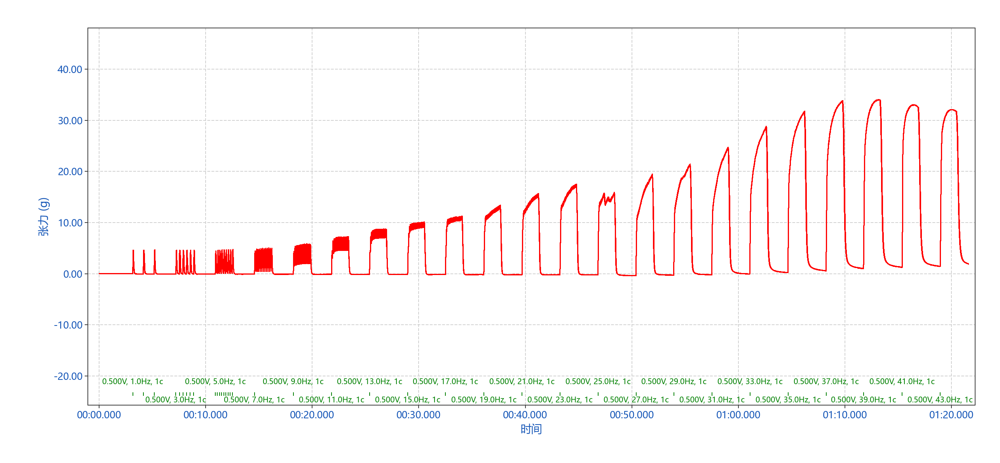

# TMEN Opener 2.1.0

查看泰盟 BL 系列的 `.tmen` 生理实验记录。支持波形浏览、电刺激标注、事件查看和图片导出。仓库中的 7 个样本已用 2.1.0 逐一核对。



## 打开文件

在 Windows 上双击 [tmen-opener-2.1.0.exe](tmen-opener-2.1.0.exe)，点击 **打开文件**，或把一个或多个 `.tmen` 文件拖进窗口。每个文件会在独立标签页打开。

| 操作 | 效果 |
|---|---|
| 左键拖动 | 平移波形 |
| 右键拖动 | 框选并放大 |
| 滚轮 / Ctrl + 滚轮 | 缩放横轴 / 纵轴 |
| 双击 / F | 复位到全图 |
| A | 按当前可视范围调整纵轴 |
| Ctrl + O / Ctrl + W | 打开文件 / 关闭当前标签页 |
| Ctrl + S | 将当前视图导出为 PNG、PDF 或 SVG |

移动鼠标可读取光标附近的时间和波形值。底部的最小值、最大值和峰峰值会随当前可视范围更新。

## 电刺激和数据详情

电刺激在横轴上方用绿色（`#008000`）短刻线和文字标注。文字按强度、频率和通道排列，例如 `5.000V, ≈20.0Hz, 1c`。横轴上的刺激时间由它在记录中的采样点位置换算得到。视图较宽时，密集的刺激按组显示。放大后可以看到逐条刻线。

`≈` 表示频率根据规律的脉冲记录间隔估算。软件保留文件中原始频率字段的值，单次且无记录频率的刺激标为「单次」。

点击 **数据详情** 可以查看以下内容。

- **实验信息**显示设备型号、采样率、起止时间和实验说明。「实验目的」「实验原理」等标题由查看器显示，正文来自文件内部的 `Config` 数据流。
- **电刺激**列出各组的起止时间和逐条记录。**事件**列出时间、类型码和值。要在波形上叠加事件，可在「子图与设置」中打开事件标记。
- **解析提示**列出未识别记录的流内偏移、可用的候选采样点和原始十六进制字节。

## 样本校验

以下结果使用随附的默认配置。「未识别」统计仍无法解释的二进制记录块。

| 样本 | 波形点数 | 刺激记录 | 刺激组 | 事件 | 未识别 |
|---|---:|---:|---:|---:|---:|
| 不完全强直到完全强直收缩的渐变 | 81,632 | 759 | 22 | 0 | 0 |
| 家兔动脉血压-打了一堆东西… | 226,560 | 0 | 0 | 0 | 0 |
| 家兔电刺激迷走神经 | 92,280 | 1,153 | 8 | 0 | 32 |
| 家兔血压-大出血记录 | 81,616 | 0 | 0 | 0 | 0 |
| 家兔血压1 | 38,416 | 0 | 0 | 0 | 0 |
| 家兔血压2 | 888 | 0 | 0 | 0 | 0 |
| 有完全强直的 | 179,424 | 600 | 484 | 7 | 9 |

7 个文件的所有波形点均已读出。4 份只有波形的血压文件中，`Stimulate` 和 `Event` 数据流为空。`家兔血压2.tmen` 的 888 个采样点与文件索引一致，时长为 4.44 秒。

### 已知解析边界

- 迷走神经文件中的 32 个刺激流记录块和完全强直文件中的 9 个记录块，具体含义尚未确认。
- `家兔血压-大出血记录.tmen` 和 `家兔血压2.tmen` 只保留了部分实验说明残片，无法从文件恢复全文。
- 事件类型 10 和 13 的时间与数值可以读取，设备给这些类型定义的含义仍待确认。部分配置、索引和刺激的内部字段也有待验证。

## 设置

在 **子图与设置** 中可调整网格、坐标格式、波形和刺激标注。程序读取同目录的 `config.json`，也可从界面保存设置。

张力通道默认减去开头 2,000 个采样点的均值，动脉血压保持绝对读数。需要按采集值查看张力时，将 `data.zero_mode` 设为 `none`。如果手动打开了平滑，也可将 `data.smooth_window` 设为 `1`。

## 从源码运行和打包

源码和 Windows 打包均已用 Python 3.11 验证。在项目目录中运行以下命令。

```powershell
python -m pip install -r requirements.txt
python main.py "data/家兔电刺激迷走神经.tmen"
```

用 PyInstaller 生成 Windows 可执行文件。

```powershell
python -m pip install pyinstaller
python -m PyInstaller tmen-opener.spec
```

打包输出位于 `dist/tmen-opener-2.1.0.exe`。

解析入口位于 [tmen/parser.py](tmen/parser.py)。`.tmen` 是 OLE2 复合文件，样本的波形来自 `Channel_Data1`，实验说明来自 UTF-16LE 编码的 `Config`，设备型号和记录时间来自 `Index`。电刺激和事件分别来自 `Stimulate` 和 `Event`。解析以仓库内的样本为依据。
