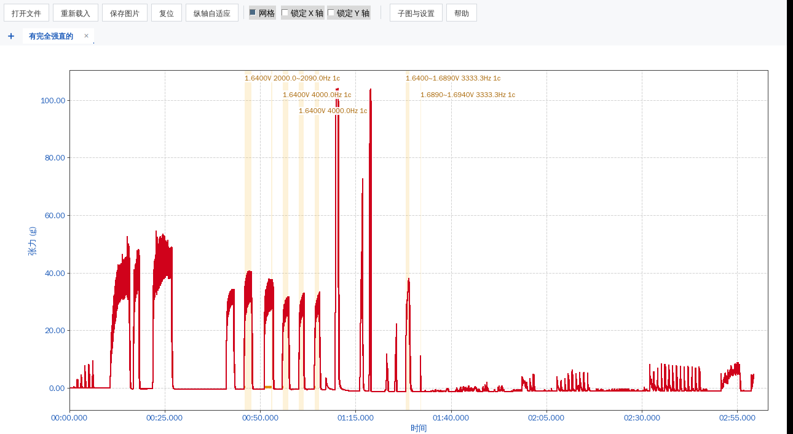

# TMEN Opener — 泰盟 BL 系列 `.tmen` 波形查看器

> 纯 Python 解析并可视化 泰盟 BL-422I / BL-420N 系列生理实验数据（`.tmen`），
> 界面配色、坐标轴、刺激标注均按泰盟原厂软件的风格还原，不需要安装官方软件。

 



---

## 1. 功能一览

| 功能 | 说明 |
|---|---|
| 多种载入方式 | 拖入窗口 / 「打开文件」/ 命令行参数，**每个文件一个标签页** |
| 多标签页 | 标签可点击切换、拖动排序、`✕` 关闭；`Ctrl+O` 打开、`Ctrl+W` 关闭 |
| 交互 | **左键拖动＝平移**、**右键拖动＝框选缩放**、**滚轮＝横轴缩放**、**Ctrl+滚轮＝纵轴缩放**、双击复位 |
| 轴锁定 | 工具栏「锁定 X 轴 / 锁定 Y 轴」两个勾选框，勾上后该方向不动 |
| 悬浮读数 | 鼠标停在曲线上，窗口底部实时显示该点的 **时间（分:秒.毫秒）** 与 **纵轴数值** |
| 可视段统计 | 底部右侧实时显示**当前画面**的最小值、最大值、峰峰值（不是全文件！） |
| 电刺激标注 | 从 `Stimulate` 流逆向出刺激参数，按组在图上画出竖线、时间色带与文字（强度 V / 频率 Hz / 通道 c） |
| 单像素绘图 | 波形、坐标轴、网格线宽都以「设备像素」为单位换算，导出的 PNG 与屏幕完全一致，不会变粗、不会出现半透明羽化边 |
| 配置外置 | 全部可调参数集中在 `config.json`，程序内「子图与设置」窗口可修改**任何一项**并即时生效 | 
| 导出 | 当前视图导出 PNG / PDF / SVG（线宽恒为 1 像素） |

### 配色（对齐泰盟 BL 软件）

| 元素 | 颜色 | 线型 |
|---|---|---|
| 刻度数字 | `#1858B8` | — |
| 坐标轴 | `#404040` | 实线，1 px |
| 网格 | `#D2D2D2` | 虚线，1 px |
| 波形 | `#D0021B`（可改） | 实线，1 px |

---

## 2. 安装与运行

```bash
pip install -r requirements.txt

python main.py                      # 空窗口，拖入或点「打开文件」
python main.py data/有完全强直的.tmen   # 直接打开，可传多个文件
```

依赖：`numpy`、`matplotlib`、`olefile`；`tkinterdnd2` 可选（仅拖放需要）。

---

## 3. 项目结构

```
tmen-opener/
├── main.py                 # 入口：DPI 适配 + 创建窗口
├── config.json             # 全部可配置项（首次运行自动生成）
├── requirements.txt
├── tmen-opener.spec        # PyInstaller 打包配置
├── tmen/
│   ├── config.py           # 配置：字段表 / 读写 / 派生值（唯一数据源）
│   ├── parser.py           # .tmen 解析：波形、采样率、刺激、事件
│   ├── style.py            # 泰盟风格样式、时间格式化、像素→磅换算
│   ├── plot.py             # PlotPage：一个标签页 = 一张图 + 交互 + 读数
│   ├── dialogs.py          # Subplot configuration tool（子图布局 + 全部设置）
│   └── ui.py               # 主窗口：工具栏、标签栏、状态栏、拖放
└── data/                   # 示例数据
```

拆分原则：**解析、样式、绘图、界面互不依赖**。
`parser.py` 不 import tkinter，`style.py` 不 import 界面，方便单独复用（批量转换、脚本分析）。

---

## 4. 交互说明

| 操作 | 效果 |
|---|---|
| 左键拖动 | 平移（受「锁定 X/Y 轴」约束） |
| 右键拖动 | 框选矩形放大；`Ctrl` + 右键拖动＝等比缩放（锁定纵横比） |
| 滚轮 | 以光标为中心缩放**横轴** |
| `Ctrl` + 滚轮 | 以光标为中心缩放**纵轴** |
| 双击 | 复位到全图 |
| `←` / `→` | 左右平移（每次 1/4 视野） |
| `A` | 纵轴自适应到**当前可视段** |
| `F` | 复位全图 |
| `Ctrl+O` / `Ctrl+S` / `Ctrl+W` | 打开 / 保存图片 / 关闭当前标签 |

> 所有左键功能都**单击即生效**，不需要先在工具栏点「平移/缩放」按钮——
> 因为本版本已经彻底移除 matplotlib 自带的 `NavigationToolbar`（就是它需要先按按钮，
> 也是它导致「左键要先双击才动」的图层问题），改成自己实现的事件处理。

---

## 5. 配置文件 `config.json`

程序内「子图与设置 → 全部设置」由 `tmen/config.py` 的字段表**自动生成**：
配置文件里加一项，界面就自动多一个控件，所以「修改配置文件中的一切内容」是字面意义上的。

| 小节 | 内容 |
|---|---|
| `app` | 窗口标题/尺寸、绘图 DPI、降采样目标点数、关闭标签页确认 |
| `data` | 数据流名、采样率回退值、采样率取整、平滑窗口、**零点校正模式**、通道单位表 |
| `style` | 波形/坐标轴/网格/刻度数字/标题的颜色、线宽（像素）、字号、字体、网格线型 |
| `time_axis` | 横轴格式 `mm:ss.mmm` / `mm:ss` / `ss.mmm` / `seconds`、右端留白 |
| `y_axis` | 纵轴数字格式、自适应留白比例 |
| `interaction` | 滚轮缩放系数、左右键分工、Ctrl 锁定纵横比、悬浮标记、最小跨度 |
| `stimulus` | 刺激竖线/色带/文字的颜色线宽、文字模板、最多行数、合并间隔、有效范围 |
| `events` | `Event` 流标记的颜色、字号、文字模板 |
| `status` | 底部读数精度、是否显示最大最小/峰峰值 |
| `subplot` | 子图四边距与间距（「子图布局」页签的默认值） |

### 零点校正 `data.zero_mode`

| 取值 | 含义 |
|---|---|
| `auto`（默认） | 通道名在 `zero_auto_channels` 里（如「张力」）→ 减前 N 点均值；否则（如「动脉血压」）不动 |
| `none` | 原样显示 |
| `first` / `median` / `min` | 分别减前 N 点均值 / 中位数 / 全段最小值 |

**为什么需要它**：`张力` 通道的应变片存在零点偏置（静息时读到 2~3 g），
减去之后曲线才落回 0 附近，峰峰值也才是真实的收缩幅度；
而 `动脉血压` 是绝对量（mmHg），**不能**减基线，否则会变成在 0 附近上下波动。

---

## 6. 文件格式逆向说明

`.tmen` 是 **OLE2 复合文档**（`D0 CF 11 E0 A1 B1 1A E1`），用 `olefile` 打开。

| 流 | 大小（示例） | 内容 |
|---|---|---|
| `Channel_Data1` | 717696 | 波形本体，**float32 小端，无头部** |
| `Config` | 6188 | 定长结构：采样率、通道名、实验项目名/目的/方法 |
| `Index` | 3932 | 设备型号、样本数、开始/结束时间戳 |
| `Stimulate` | 26796 | 电刺激参数记录，**44 字节/条** |
| `Event` | 280 | 实验事件标记，**40 字节/条** |
| `Analysis` / `Measure` | 0 | 本类实验为空 |

### 6.1 `Config`

| 偏移 | 类型 | 含义 |
|---|---|---|
| `0x46` | float32 | 采样率（1000.0 / 200.0039…） |
| `0x39A` | UTF-16LE | 通道名，如 `张力`、`动脉血压`（`\0` 结尾） |
| 其后 | UTF-16LE | 实验项目名（如 `刺激强度与反应的关系`）、实验目的、方法… |

> `200.0039` 这种值是设备把 5 ms 采样间隔写成浮点的产物，
> `data.snap_sample_rate=true` 时会自动取整为 `200`，横轴更整齐。

### 6.2 `Stimulate`（电刺激记录，每 44 字节）

| 偏移 | 类型 | 含义 | 示例 |
|---|---|---|---|
| `+0` | int32 | 记录类型，`1` = 有效记录 | 1 |
| `+4` | int16 | **刺激通道** | 1 |
| `+6` | int16 | 组内第一拍标记 | 1 / 0 |
| `+8` | int32 | **刺激模式**，`0x00020000` = 连续/串刺激（带频率）；`0` = 参数快照 | 131072 |
| `+12` | int32 | 累计刺激拍数 | 1 |
| `+16` | float32 | 波宽 (ms) | 0.05 |
| `+20` | float32 | 刺激间隔 (ms) | 0.25 |
| `+24` | float32 | 刺激间隔 (ms) 的另一种写法 | 0 或 333.3 |
| `+28` | float32 | **频率 (Hz)** | 4000.0 |
| `+32` | float32 | **强度 (V)** | 1.64 |
| `+36` | int32 | 保留 | 0 |
| `+40` | int32 | **采样点序号** → 时间 = idx / fs | 55872 |

- 记录里混有少量无效块（`+0` 不是 1，内容像内存残留），解析时直接丢弃。
- 相邻、同通道、频率/强度连续的记录会**合并成一组**（默认间隔 ≤ 0.25 s），
  对应图上的一段强直刺激；频率/强度在组内变化时用 `2000.0~2090.0` 这样的区间表示。
- 图上的文字形如 `1.6400V 4000.0Hz 1c`：强度 V / 频率 Hz / 通道 c，模板可在配置里改。

### 6.3 `Event`（事件标记，每 40 字节）

`+0` int32（高 16 位是类型 10/13）、`+8` float32（标记值）、`+16` int32（采样点序号）。
默认不显示，需要时在设置里打开 `events.enabled`。

### 6.4 容易踩的坑

- 数据流前面**没有** 1024 字节头，第一个 float32 就是第一个采样点；
  按 int16 读会得到剧烈跳变的假波形。
- 文件可能被截断（本仓库 `家兔血压2.tmen` 只有 888 点 / 4.44 s），
  `Index` 里记录的样本数可以和实际长度不一致，程序会在状态栏提示。

---

## 7. 这一版改了什么

**结构**

- 271 行的单文件拆成 `config / parser / style / plot / dialogs / ui` 六个模块，配置文件独立成 `config.json`。
- 删除旧的可执行文件与旧 spec（PyInstaller 产物，体积 32 MB，且已过期），新增可复现的 `tmen-opener.spec`。

**显示与统计**

- 峰峰值、最大值、最小值改为统计**当前可视段**（用原始分辨率数组算，不受降采样影响）。
- 横轴改为 `分:秒.毫秒`（`01:21.131`），可切换其它格式。
- 波形绘制改成「像素列 min/max 包络」降采样：缩放时既不卡，也不会像等间隔抽点那样丢掉尖峰。
- 坐标轴/网格/波形线宽按 DPI 换算成像素，关掉抗锯齿，**导出图片也是 1 像素**，不再出现半透明羽化边。

**交互**

- 移除 matplotlib 自带 `NavigationToolbar`（内置 pan/zoom 必须先按按钮、左键还要双击才响应），
  自己实现鼠标事件：左键平移、右键框选缩放、滚轮缩放横轴、`Ctrl+滚轮` 缩放纵轴，全部单击生效。
- 「锁定 X/Y 轴」改成工具栏两个勾选框；`Ctrl` 锁定纵横比保留。
- 鼠标悬浮显示该点坐标（时间 + 数值 + 点序号），用 blit 局部刷新，移动时不重绘整张图。
- 新增多标签页：可拖动排序、可关闭，拖入多个文件自动多开。

**逆向修正**

1. **电刺激标注**：解析 `Stimulate` 流（44 字节记录），合并成刺激组，在图上画竖线 + 时间色带 + 参数文字 `1.6400V 4000.0Hz 1c`。
2. **`有完全强直的.tmen` 的最小值不再是 2.56**：张力通道的静息基线本身带约 3 g 的零点偏置，
   旧版没有做零点校正，曲线的"底"一直浮在 2~3 上（某个区段的最小值正好落在 2.56），
   看上去就像数据没处理干净。现在 `data.zero_mode=auto` 会按通道自动减掉静息均值（3.168），
   静息段回到 0 附近，最小值变为 -1.46，与官方软件看到的基线一致。
3. **`家兔血压2.tmen` / `家兔血压-大出血记录.tmen` 不再在 0 附近波动**：
   根因是旧版无条件执行 `data = arr - arr[:2000].mean()`，把 100 mmHg 的绝对压力整体减掉了均值。
   现在 `动脉血压` 这类绝对量默认不做基线校正，显示的是真实 100~150 mmHg；
   另外 `家兔血压2.tmen` 本身只录到 4.44 s（888 点，`Index` 与实际长度一致），所以曲线很短，属正常。

---

## 8. 打包成 exe

```bash
pip install pyinstaller
pyinstaller tmen-opener.spec
```

`config.json` 会作为数据文件一起打包；运行时优先读写 exe 同目录的 `config.json`。

---

## 9. 免责声明

本项目为非官方逆向工程成果，格式解析基于 BL-420N/BL-422I 样本文件，
不同固件版本可能存在差异。请勿用于商业用途；涉及真实实验数据时请遵守所在机构的数据管理规范。
